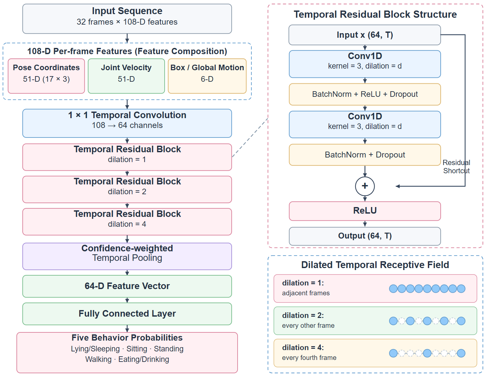
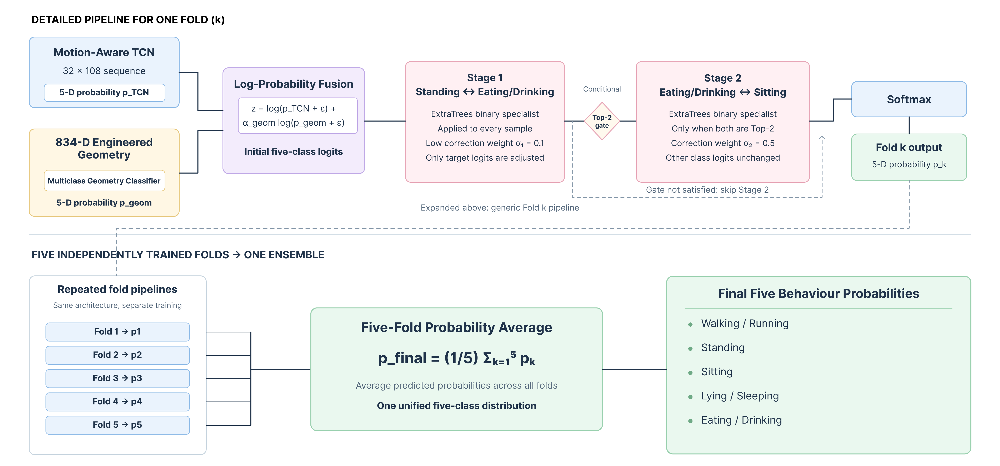
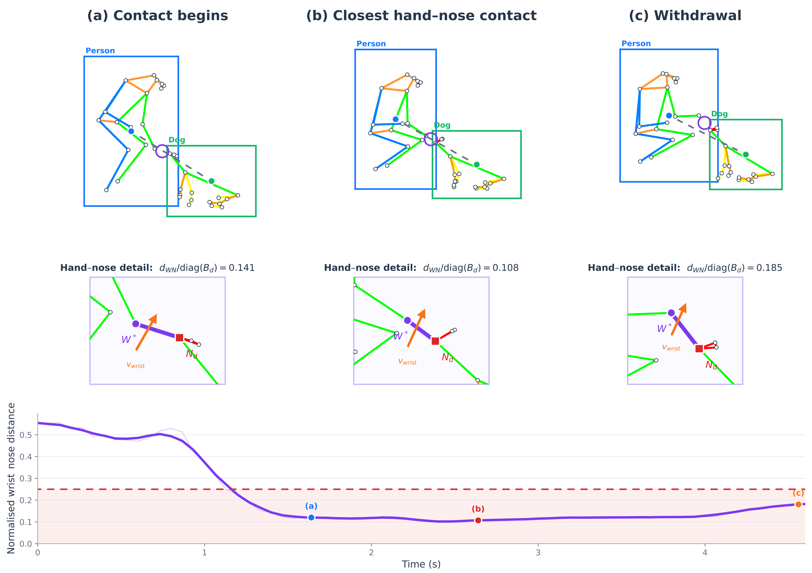
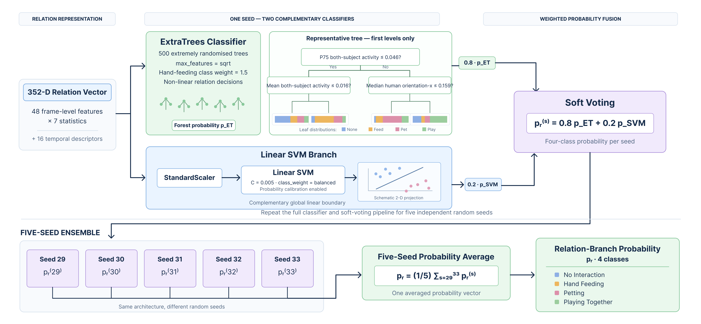
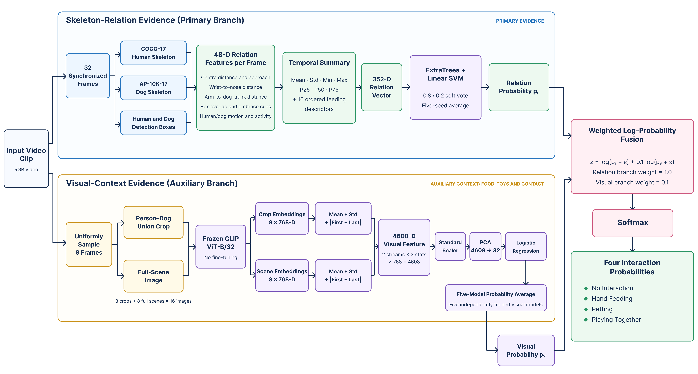
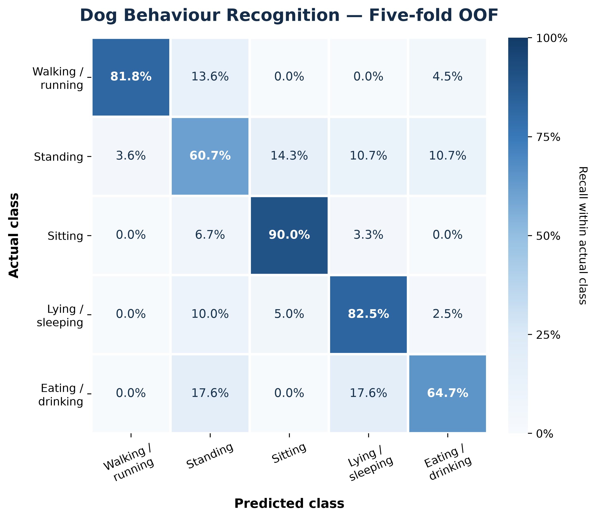
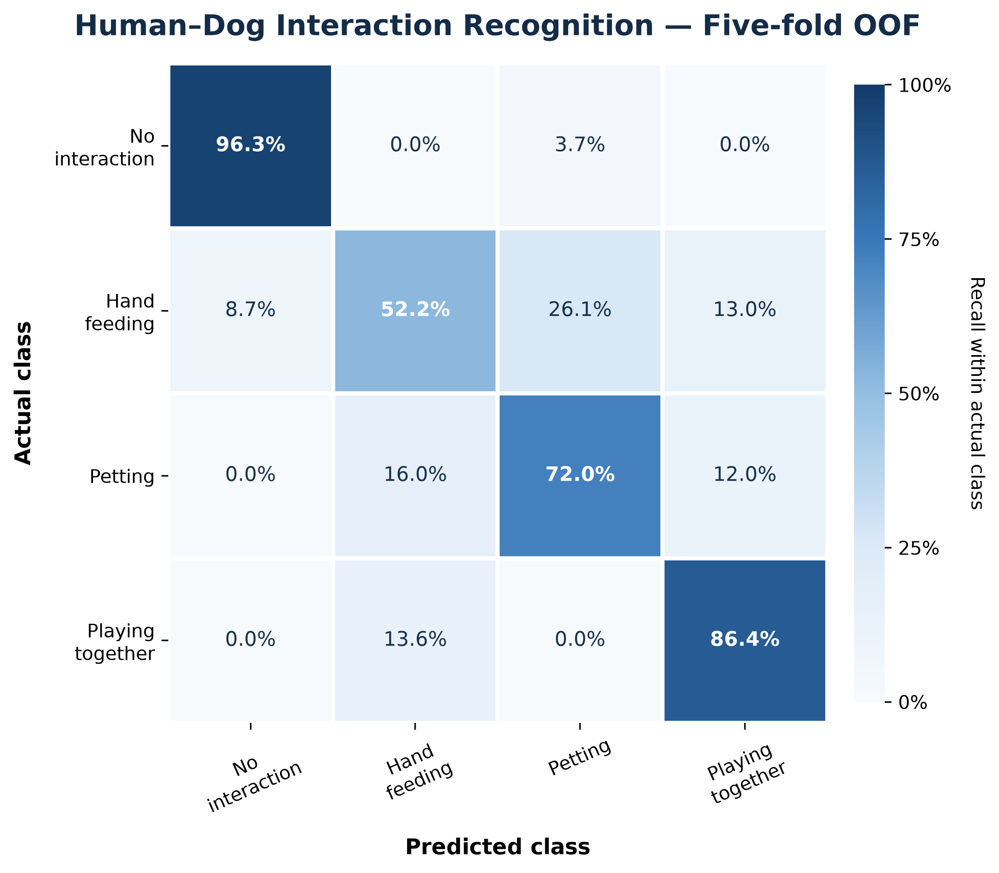

# Final Report: Skeleton-Based Dog Behaviour and Human-Dog Interaction Recognition

**Group 28 · PRS Practice Module**

## Table of Contents

- [Abstract](#abstract)
- [1. Introduction](#1-introduction)
  - [1.1 Background and Motivation](#11-background-and-motivation)
  - [1.2 Problem Statement](#12-problem-statement)
  - [1.3 Objectives and Scope](#13-objectives-and-scope)
  - [1.4 Report Organisation](#14-report-organisation)
- [2. Datasets](#2-datasets)
  - [2.1 Data Sources](#21-data-sources)
  - [2.2 Dog Behaviour Clips](#22-dog-behaviour-clips)
  - [2.3 Human-Dog Interaction Clips](#23-human-dog-interaction-clips)
  - [2.4 Dog Pose Data (Hand-Labelled Evaluation Set and APT-36K)](#24-dog-pose-data-hand-labelled-evaluation-set-and-apt-36k)
  - [2.5 Annotation and Data Preparation Pipeline](#25-annotation-and-data-preparation-pipeline)
  - [2.6 Data Splits and Leakage Control](#26-data-splits-and-leakage-control)
- [3. Tools and Techniques](#3-tools-and-techniques)
  - [3.1 Software Stack and Frameworks](#31-software-stack-and-frameworks)
  - [3.2 Object Detection (RTMDet)](#32-object-detection-rtmdet)
  - [3.3 Pose Estimation (RTMPose)](#33-pose-estimation-rtmpose)
  - [3.4 Multi-Target Tracking and Skeleton Extraction](#34-multi-target-tracking-and-skeleton-extraction)
  - [3.5 Skeleton Preprocessing and Normalisation](#35-skeleton-preprocessing-and-normalisation)
  - [3.6 Temporal Modelling (TCN)](#36-temporal-modelling-tcn)
  - [3.7 Feature Engineering and Classical Classifiers](#37-feature-engineering-and-classical-classifiers)
  - [3.8 Ensemble Learning](#38-ensemble-learning)
  - [3.9 Evaluation Methods](#39-evaluation-methods)
- [4. System Design](#4-system-design)
  - [4.1 Overall System Architecture](#41-overall-system-architecture)
  - [4.2 Dual-Species Skeleton Extraction Pipeline](#42-dual-species-skeleton-extraction-pipeline)
  - [4.3 Repository and Module Structure](#43-repository-and-module-structure)
  - [4.4 Frontend Prototype](#44-frontend-prototype)
- [5. Models](#5-models)
  - [5.1 Model One: Dog Pose Estimation](#51-model-one-dog-pose-estimation)
    - [5.1.1 Baseline (P0: RTMPose-m AP-10K)](#511-baseline-p0-rtmpose-m-ap-10k)
    - [5.1.2 Fine-Tuning on APT-36K (P1)](#512-fine-tuning-on-apt-36k-p1)
    - [5.1.3 Further Adaptation (P2)](#513-further-adaptation-p2)
  - [5.2 Model Two: Dog Behaviour Recognition](#52-model-two-dog-behaviour-recognition)
    - [5.2.1 Motion-Aware TCN Backbone](#521-motion-aware-tcn-backbone)
    - [5.2.2 Engineered Geometry Features](#522-engineered-geometry-features)
    - [5.2.3 Geometry and Pairwise Fusion](#523-geometry-and-pairwise-fusion)
    - [5.2.4 Class-Specialist Models](#524-class-specialist-models)
  - [5.3 Model Three: Human-Dog Interaction Recognition](#53-model-three-human-dog-interaction-recognition)
    - [5.3.1 Human-Dog Relation Features](#531-human-dog-relation-features)
    - [5.3.2 ExtraTrees / Linear-SVM Soft-Vote Ensemble](#532-extratrees--linear-svm-soft-vote-ensemble)
    - [5.3.3 Frozen CLIP Visual Branch](#533-frozen-clip-visual-branch)
    - [5.3.4 Probability-Level Fusion](#534-probability-level-fusion)
  - [5.4 Alternative Models Explored](#54-alternative-models-explored)
- [6. System Performance](#6-system-performance)
  - [6.1 Experimental Setup](#61-experimental-setup)
  - [6.2 Evaluation Metrics](#62-evaluation-metrics)
  - [6.3 Dog Pose Estimation Results](#63-dog-pose-estimation-results)
  - [6.4 Dog Behaviour Recognition Results](#64-dog-behaviour-recognition-results)
  - [6.5 Human-Dog Interaction Recognition Results](#65-human-dog-interaction-recognition-results)
  - [6.6 Ablation Studies](#66-ablation-studies)
  - [6.7 Comparison with Alternative Models](#67-comparison-with-alternative-models)
  - [6.8 Runtime and Deployment Considerations](#68-runtime-and-deployment-considerations)
- [7. Findings and Discussion](#7-findings-and-discussion)
  - [7.1 Key Findings](#71-key-findings)
  - [7.2 Error Analysis](#72-error-analysis)
  - [7.3 Impact of Detection and Tracking Quality](#73-impact-of-detection-and-tracking-quality)
  - [7.4 Data Quality, Size and Leakage](#74-data-quality-size-and-leakage)
  - [7.5 Limitations](#75-limitations)
  - [7.6 Future Work](#76-future-work)
- [8. Conclusion](#8-conclusion)
- [References](#references)
- [Appendix](#appendix)
  - [A. Installation and User Guide](#a-installation-and-user-guide)
  - [B. Model Training and Reproduction Commands](#b-model-training-and-reproduction-commands)
  - [C. Dataset and Model File Listing](#c-dataset-and-model-file-listing)
  - [D. Additional Results](#d-additional-results)

---

## Abstract

## 1. Introduction

### 1.1 Background and Motivation

### 1.2 Problem Statement

### 1.3 Objectives and Scope

### 1.4 Report Organisation

## 2. Datasets

### 2.1 Data Sources

The project combines public pose data with a project-curated video collection. For dog-pose adaptation, the dog subset of APT-36K is used while retaining its official training and validation separation. It provides animal pose supervision that is independent of the project videos and is converted to the 17-keypoint convention used by the dog-pose branch. The hand-labelled pose evaluation images are kept separate from behaviour and interaction labels and are described in Section 2.4.

The dog-behaviour and human--dog interaction datasets were assembled from project-contributed clips and publicly available research-use videos collected from sources including YouTube, Pexels, Mixkit, InterPet and SmartHomeBench. Selection prioritised indoor, third-person and relatively stable-camera footage in which the principal subjects were visible. A limited number of outdoor or partially occluded clips were retained when the action boundary remained unambiguous, providing moderate viewpoint and scene variation. Audio is not used by the current system.

Every original video is assigned a `source_video_id`, and each dog and person is represented by an anonymous `dog_id` or `person_id`. Source references and quality notes are retained in the manifests so that each short clip can be traced to its original video without storing personal names.

### 2.2 Dog Behaviour Clips

### 2.3 Human-Dog Interaction Clips

The interaction dataset contains **121 valid clips** drawn from **80 source videos**, with 69 anonymous dog identifiers and 69 anonymous person identifiers. Each clip contains one principal person and one principal dog and has one stable interaction label. The clips range from 1.679 to 10.239 seconds, with a mean duration of 4.830 seconds. Label transitions are cut into separate clips rather than assigning multiple sequential actions to one sample.

The four interaction classes are defined as follows:

- **No interaction:** the person and dog are both present, but there is no sustained physical contact, hand feeding or mutually engaged play. Speech, looking or gestures without contact remain in this class.
- **Hand feeding:** food or a reward is transferred from the person's hand, or from a hand-held container, towards the dog's mouth. Independent eating from a bowl is not labelled as human--dog interaction.
- **Petting:** the person's hand maintains contact with the dog's head or trunk and performs a small stroking movement. Sustained holding or embracing is also included, whereas incidental contact is excluded.
- **Playing together:** the person and dog are both actively engaged, for example through chasing, toy tugging or repeated large coordinated movements. A dog playing alone is not included in this class.

The final fixed split is shown below. The 24-clip test set is balanced with six clips per class; the remaining 97 clips form the development set used for grouped five-fold evaluation.

| Interaction class | Train | Validation | Test | Total |
|---|---:|---:|---:|---:|
| No interaction | 23 | 4 | 6 | 33 |
| Hand feeding | 18 | 5 | 6 | 29 |
| Petting | 19 | 6 | 6 | 31 |
| Playing together | 15 | 7 | 6 | 28 |
| **Total** | **75** | **22** | **24** | **121** |

### 2.4 Dog Pose Data (Hand-Labelled Evaluation Set and APT-36K)

### 2.5 Annotation and Data Preparation Pipeline

### 2.6 Data Splits and Leakage Control

The datasets are split at subject and source-video level rather than by individual frames or randomly selected clips. All clips derived from the same `source_video_id` remain in one partition. Dog and person identifiers are also checked jointly: if clips are connected through a shared dog or person, the complete connected identity group is assigned to the same partition. This prevents visually similar neighbouring clips, repeated backgrounds and repeated subjects from appearing on both sides of an evaluation boundary.

For the interaction dataset, the fixed split contains 75 training, 22 validation and 24 test clips. There is no overlap in `dog_id`, `person_id` or `source_video_id` between these partitions. Model development combines the 75 training and 22 validation clips into a 97-clip development set. Stratified grouped five-fold cross-validation is then applied to 47 connected human--dog identity components. In each round, four folds train the model and the remaining fold produces predictions for clips that were not used to fit that fold. Concatenating the five validation predictions yields one out-of-fold prediction for every development clip.

The final interaction ensemble is fitted on all 97 development clips, while the 24-clip test set is excluded from weight fitting and reported only as supporting evidence. Video cutting, frame sampling, pose extraction, feature generation and augmentation inherit the previously assigned split; they are not performed before grouping. The same principle is used for dog-behaviour data, with `dog_id` and `source_video_id` acting as the primary grouping keys.

## 3. Tools and Techniques

### 3.1 Software Stack and Frameworks

### 3.2 Object Detection (RTMDet)

### 3.3 Pose Estimation (RTMPose)

### 3.4 Multi-Target Tracking and Skeleton Extraction

### 3.5 Skeleton Preprocessing and Normalisation

### 3.6 Temporal Modelling (TCN)

Temporal Convolutional Networks (TCNs) model a sequence using one-dimensional convolutions along the temporal axis. In comparison with a recurrent model, all time positions within a layer can be processed in parallel. Dilated convolution enlarges the temporal receptive field without reducing sequence length, while residual connections support the training of deeper temporal models. These properties make a TCN suitable for recognising actions from short skeleton sequences, where both frame-to-frame joint motion and longer-duration posture patterns are important.

For a residual temporal block, the output can be expressed as

\[
\mathbf{H}_{l+1}=\operatorname{ReLU}\left(\mathbf{H}_{l}+F_l(\mathbf{H}_{l})\right),
\]

where \(F_l\) contains temporal convolutions, normalisation, activation and dropout. The dilations used in this project increase across successive blocks, allowing the model to combine local motion with information from a wider temporal range.

### 3.7 Feature Engineering and Classical Classifiers

Deep temporal features are complemented by explicit geometric and motion descriptors. These descriptors include joint positions, joint velocities, body proportions, head orientation, detection-box displacement, movement duration and statistics computed over a complete clip. Such features are useful in a small-data setting because they directly encode domain-relevant cues, such as prolonged head lowering during eating or sustained hand-to-dog proximity during petting.

The project uses Extremely Randomised Trees (ExtraTrees), linear Support Vector Machines (SVMs) and logistic regression for different feature branches. ExtraTrees averages a large collection of randomised decision trees and can represent non-linear thresholds in distance, duration and motion features. A linear SVM provides a complementary global decision boundary after feature standardisation. For high-dimensional visual features, Principal Component Analysis (PCA) is applied before logistic regression to reduce dimensionality and limit overfitting.

### 3.8 Ensemble Learning

Ensembling is used at three levels. First, classifier probabilities from complementary feature branches are combined by weighted soft voting or weighted log-probability fusion. Second, class-pair correction models refine decisions between selected confusable classes. Third, predictions from five cross-validation folds or five random-seed models are averaged at inference time. The saved fold weights therefore form one ensemble model rather than five separate model designs.

ExtraTrees is itself a **homogeneous ensemble**, because it combines many classifiers of the same type: randomised decision trees. Combining ExtraTrees with a linear SVM creates a **heterogeneous ensemble classifier**, since the two component models have different assumptions and decision functions. The complete interaction system further combines skeleton-relation and CLIP visual features; it can therefore be described more precisely as a heterogeneous ensemble with multi-branch feature fusion rather than simply as a hybrid machine-learning model.

The combination is also motivated by the bias--variance trade-off. Individual decision trees can learn non-linear thresholds and feature interactions but may have high variance on a small dataset. ExtraTrees reduces this variance through feature/threshold randomisation and probability averaging across 500 trees, potentially at the cost of a small increase in bias. In contrast, the regularised linear SVM has a simpler and more stable decision boundary but can have higher bias when the true class boundary is non-linear. Weighted soft voting is intended to retain the non-linear capacity of ExtraTrees while using the SVM as a stable complementary classifier. This is a design motivation rather than proof that variance has been reduced; the claim must be supported by controlled component comparisons.

### 3.9 Evaluation Methods

Model development uses five-fold grouped cross-validation. Four folds are used for training and the remaining fold for validation, so each development sample receives one prediction from a model that was not trained on that sample. Combining these predictions produces the out-of-fold (OOF) result. OOF Accuracy, Macro-F1 and the confusion matrix are the primary evidence used for model comparison.

A small held-out test set is also evaluated after model development. Because the number of test clips is limited, its results are treated as supporting evidence that the end-to-end approach is feasible rather than as the main estimate of generalisation performance.

## 4. System Design

### 4.1 Overall System Architecture

### 4.2 Dual-Species Skeleton Extraction Pipeline

### 4.3 Repository and Module Structure

### 4.4 Frontend Prototype

## 5. Models

### 5.1 Model One: Dog Pose Estimation

#### 5.1.1 Baseline (P0: RTMPose-m AP-10K)

#### 5.1.2 Fine-Tuning on APT-36K (P1)

#### 5.1.3 Further Adaptation (P2)

### 5.2 Model Two: Dog Behaviour Recognition

The dog-behaviour model receives a temporal sequence of AP-10K 17-joint dog skeletons and predicts one of five classes: walking/running, standing, sitting, lying/sleeping, and eating/drinking. Every clip is converted to \(T=32\) frames. Each joint contains an \(x\)-coordinate, a \(y\)-coordinate and a confidence score, giving a basic input tensor

\[
\mathbf{X}\in\mathbb{R}^{32\times17\times3}.
\]

Missing keypoints are temporally interpolated where possible, coordinates are normalised using image and body scale, and a frame mask distinguishes observed frames from padded positions. Unlike a representation based only on frame-wise centred skeletons, the proposed input retains detection-box motion so that movement across the image is not discarded.

#### 5.2.1 Motion-Aware TCN Backbone

At each time position, the network receives three groups of features:

1. 51 pose values from the 17 joints and their confidence scores;
2. 51 first-order temporal differences describing joint motion; and
3. six global motion values derived from the dog detection box, including centre displacement and scale change.

The resulting 108-dimensional vector is projected to 64 channels by a \(1\times1\) convolution. It then passes through three residual TCN blocks with kernel size 3 and dilation rates 1, 2 and 4. All temporal convolutions use stride 1 and suitable padding; therefore, the sequence remains 32 frames long throughout the backbone rather than being temporally downsampled.

The frame-level features are aggregated by confidence-weighted temporal pooling:

\[
\mathbf{h}=\frac{\sum_{t=1}^{T}w_t\mathbf{H}_t}
{\sum_{t=1}^{T}w_t+\epsilon},
\]

where \(w_t\) is the mean confidence of the 17 joints in frame \(t\). During training, an auxiliary moving-versus-static head encourages the backbone to distinguish high-motion behaviours from stable postures. Only the five-class behaviour head is used during inference.

*Figure 5-1. Architecture of the motion-aware TCN. Each 32-frame sequence contains 108 features per frame: 51 pose-coordinate channels, 51 joint-velocity channels and six detection-box/global-motion channels. A \(1\times1\) temporal projection maps the input to 64 channels, followed by three residual temporal blocks with dilation rates 1, 2 and 4. Confidence-weighted temporal pooling produces a 64-dimensional clip representation for five-class prediction. The right-hand panels detail the residual block and the increasing temporal receptive field.*

#### 5.2.2 Engineered Geometry Features

The dataset is relatively small, and several classes differ through cues that are difficult to learn reliably from the TCN alone. The system therefore constructs an additional 834-dimensional clip-level vector from the normalised AP-10K skeleton and the six global-motion channels. The vector contains four concatenated feature blocks:

| Feature block | Dimension | Main information |
|---|---:|---|
| General motion summary | 160 | Detection-box translation and scale change; whole-body and per-joint motion |
| Standing-oriented block | 230 | General motion plus paw support, limb extension, trunk orientation and stillness |
| Eating-oriented block | 262 | General motion plus head-lowering geometry, head motion and low-head duration |
| Walking-oriented block | 182 | General motion plus path persistence, speed, acceleration and paw dynamics |
| **Concatenated vector** | **834** | Input to the engineered-feature classifier |

The feature blocks were originally designed for class-specific specialists and were later concatenated without changing their interfaces. Consequently, the 160-dimensional general-motion summary is present in the general block and is repeated inside the three class-oriented blocks. The 834 dimensions therefore represent the implemented concatenated vector rather than 834 unique physical quantities.

For any frame-level signal \(q_t\), the main temporal summary is

\[
S(q)=\left[\operatorname{mean}(q),\operatorname{std}(q),
\min(q),\max(q),Q_{25}(q),Q_{50}(q),Q_{75}(q)\right].
\]

The **160-dimensional general-motion summary** contains ten frame-level signals: the two-dimensional displacement of the detection-box centre from the first frame, its two-dimensional velocity, relative log-scale, scale velocity, displacement magnitude, centre speed, mean joint speed and maximum joint speed. Applying the seven statistics above gives 70 values. Five additional clip-level quantities describe accumulated centre and joint motion and the horizontal and vertical movement ranges. Finally, each of the 17 joints contributes its mean speed, maximum speed, 90th-percentile speed, spatial range and mean confidence, giving another \(17\times5=85\) values. The total is therefore \(70+5+85=160\).

**(a) Standing-oriented geometry.** The system uses the four AP-10K limb chains: shoulder--elbow--front paw and hip--knee--rear paw on the left and right sides. For each leg, an extension ratio is calculated as

\[
r_{\mathrm{leg}}=
\frac{\lVert\mathbf{p}_{\mathrm{proximal}}-\mathbf{p}_{\mathrm{paw}}\rVert}
{\lVert\mathbf{p}_{\mathrm{proximal}}-\mathbf{p}_{\mathrm{middle}}\rVert+
 \lVert\mathbf{p}_{\mathrm{middle}}-\mathbf{p}_{\mathrm{paw}}\rVert}.
\]

The model also measures the vertical spread of the four paws, their position below the neck/tail-root body axis, the horizontal orientation of the neck-to-tail vector, visible-paw confidence, detection-box centre speed, and mean and maximum joint speed. These ten frame-level signals are each summarised by \(S(\cdot)\), adding 70 values to the 160-dimensional general summary and producing the 230-dimensional standing block. A standing sequence is therefore represented by extended supporting limbs, relatively aligned paws, a near-horizontal trunk and low motion, rather than by a single static pose.

**(b) Eating-oriented geometry.** This block focuses on the nose (joint 2), neck (3), tail root (4), shoulders (5 and 8), front paws (7 and 10) and rear paws (13 and 16). Its main distances are the nose-to-nearest-front-paw distance, nose height relative to the four-paw ground estimate, nose drop relative to the neck and shoulder midpoint, and the nose-to-neck distance normalised by neck-to-tail trunk length. Nose speed, neck speed, centre speed, paw-height spread and relevant keypoint confidences complete 12 frame-level signals, which contribute \(12\times7=84\) statistics. Twelve duration features measure the proportion and longest continuous run of low-head, strongly-low-head and low-head-with-low-body-motion frames, as well as head-drop percentiles. Six further values describe vertical head-direction changes, nose movement range, accumulated nose/centre motion and valid sequence length. Together with the general summary, this gives \(160+84+12+6=262\) dimensions. These duration features distinguish sustained eating/drinking patterns from a brief downward glance.

**(c) Walking-oriented geometry.** This block adds 22 descriptors to the general summary. They include total centre-path length, net displacement and trajectory straightness,

\[
r_{\mathrm{path}}=
\frac{\lVert\mathbf{c}_{T}-\mathbf{c}_{1}\rVert}
{\sum_{t=2}^{T}\lVert\mathbf{c}_{t}-\mathbf{c}_{t-1}\rVert+\epsilon},
\]

together with speed and acceleration statistics, the proportion of moving frames, direction changes, four-paw speed and vertical-direction reversals, and detection-box scale variation. Walking/running is consequently supported by persistent global translation and coordinated paw dynamics rather than by large joint motion alone.

Thus, the engineered branch combines single-joint trajectories, distances and ratios between selected joints, whole-body detection-box motion, and temporal duration/statistical descriptors. The implementation does not calculate a comprehensive set of anatomical joint angles; “limb-extension ratios and trunk orientation” is a more precise description of the geometry used.

*Figure 5-2. Engineered geometry and motion cues used by the dog-behaviour classifier. The columns show (a) standing, (b) eating/drinking, and (c) walking/running. From top to bottom, each column presents the input image with the estimated AP-10K skeleton, the isolated skeleton with 0-based joint indices, and the corresponding engineered-feature illustration. The blue annotations identify the class-relevant geometry, motion, confidence, duration, trajectory and detection-box signals described in this section.*

#### 5.2.3 Geometry and Pairwise Fusion

For each fold, the TCN probability and the engineered-feature classifier probability are fused in log-probability space:

\[
\mathbf{z}=\log(\mathbf{p}_{\mathrm{TCN}}+\epsilon)
+\alpha\log(\mathbf{p}_{\mathrm{geom}}+\epsilon).
\]

Log-probability fusion allows the geometry branch to adjust the temporal model while retaining the TCN as the principal sequence encoder. The fused logits are converted back to class probabilities before class-pair refinement.

#### 5.2.4 Class-Specialist Models

Two ExtraTrees pairwise specialists refine class pairs that remained difficult in the cross-validation confusion matrix. The first specialist distinguishes standing from eating/drinking. It applies a low-weight correction (\(\alpha=0.1\)) to this pair for every sample, while leaving the other three class logits unchanged. The second specialist distinguishes eating/drinking from sitting and applies a stronger correction (\(\alpha=0.5\)) only when these two classes occupy the top two candidate positions. Each specialist converts its binary probability into a smoothed log-odds value, adds the weighted value to the positive-class logit, and subtracts it from the negative-class logit. This design focuses additional capacity on the two difficult decision boundaries without replacing the original five-class prediction.

The complete dog-behaviour system contains five models produced by five-fold cross-validation. Their output probabilities are averaged during inference. The five stored weights are components of one final ensemble, not five competing behaviour models.

*Figure 5-3. Final dog-behaviour ensemble. Within each fold, the Motion-Aware TCN probabilities are fused with the 834-dimensional engineered-geometry classifier in log-probability space. Two ExtraTrees specialists then refine the standing--eating/drinking and eating/drinking--sitting boundaries, with the second correction enabled only when the relevant classes occupy the top two positions. Softmax probabilities from the five independently trained folds are averaged to produce the final five-class prediction.*

### 5.3 Model Three: Human-Dog Interaction Recognition

The interaction model predicts no interaction, hand feeding, petting, or playing together from synchronised COCO-17 human skeletons, AP-10K-17 dog skeletons, detection boxes and selected RGB frames. The design separates interpretable skeleton-relation evidence from complementary visual context.

#### 5.3.1 Human-Dog Relation Features

For each frame, the system extracts a 48-dimensional relation vector from the synchronised human skeleton, dog skeleton and two detection boxes. These features preserve cross-subject geometry that would be lost if the two skeletons were normalised independently. They are organised into five groups:

- **Global person-dog geometry:** relative box-centre displacement, centre distance, relative velocity and closing speed.
- **Hand-to-mouth geometry:** vectors and distances from both COCO wrists to AP-10K joint 2. Because AP-10K has no mouth landmark, the dog's nose is used as a stable mouth proxy. Contact distances are divided by the dog-box diagonal so that their scale remains comparable across near and distant views.
- **Arm-to-trunk contact:** minimum distances from the wrists, elbows, sampled arm segments and human torso to the dog's trunk graph, together with continuous contact scores and binary contact indicators.
- **Posture and contact context:** human and dog orientation, keypoint confidence, detection-box overlap, relative stillness, arm-crossing evidence and an approximate embrace score.
- **Interaction motion:** human and dog box-centre speed, mean and maximum skeleton speed, wrist and elbow speed, acceleration, single-subject activity, joint activity and a playing-motion score.

For a 32-frame clip, every relation channel is summarised by its mean, standard deviation, minimum, maximum, and 25th, 50th and 75th percentiles, producing \(48\times7=336\) values. These order-independent statistics describe the distribution of each relation but cannot represent whether a hand first approaches, remains near and then withdraws from the dog's mouth. The system therefore adds 16 ordered descriptors for hand feeding. They encode the longest near/contact run, stable-contact proportion, start/minimum/end hand-nose distance, approach and withdrawal magnitude, whether the active hand is closer to the nose than to the trunk, dominant-hand consistency, hand-switch frequency, extreme closing and withdrawal speed, and an approach-duration interaction term. The final relation vector has

\[
48\times7+16=352
\]

dimensions.

*Figure 5-4. Hand-feeding example generated from the actual RTMDet and RTMPose outputs for clip `d50_p52_v01_c001`. The upper row shows the human COCO-17 skeleton, dog AP-10K skeleton and their detection boxes at (a) contact onset, (b) the closest hand--nose contact and (c) withdrawal onset. The middle row enlarges the nearest human wrist \(W^{\ast}\) and dog nose \(N_d\). Their scale-normalised distance is \(d_{WN}/\operatorname{diag}(B_d)\), where \(B_d\) is the dog detection box; the three selected frames yield 0.141, 0.108 and 0.185, respectively. The orange arrow denotes wrist displacement direction between the selected frames. The lower plot shows the frame-level distance over the complete clip together with a five-frame smoothed curve. The red dashed line is the implemented contact threshold of 0.25, and the shaded area denotes the contact region. Skeleton links use the official MMPose COCO-17 and AP-10K colour conventions.*

#### 5.3.2 ExtraTrees / Linear-SVM Soft-Vote Ensemble

The relation branch combines an ExtraTrees classifier containing 500 decision trees with a linear SVM. Each tree learns non-linear decisions using relation features such as contact distance, duration and activity, while the linear SVM learns a complementary global boundary on the standardised 352-dimensional vector. Their probabilities are combined by soft voting:

\[
\mathbf{p}_{r}=0.8\mathbf{p}_{\mathrm{ET}}+0.2\mathbf{p}_{\mathrm{SVM}}.
\]

Five classifiers are trained with random seeds 29--33, and their probabilities are averaged to obtain the final relation-branch probability \(\mathbf{p}_{r}\).

*Figure 5-5. Relation-branch ensemble for human--dog interaction recognition. The 352-dimensional relation vector is processed by a 500-tree ExtraTrees classifier and a standardised linear SVM. Their class probabilities are combined using weights of 0.8 and 0.2, respectively. The complete classifier is trained with five random seeds, and the resulting probability vectors are averaged to obtain the final four-class relation prediction. The representative tree shows only its first decision levels.*

#### 5.3.3 Frozen CLIP Visual Branch

Skeletons do not explicitly show food, toys or whether physical contact has actually occurred. A frozen CLIP ViT-B/32 encoder is therefore used as an auxiliary visual branch. Its parameters are not fine-tuned, reducing the risk of overfitting on the small interaction dataset.

Eight frames are sampled uniformly from each clip. For every sampled frame, the system generates both a union crop covering the person and dog and a full-scene image, producing 16 images in total. CLIP encodes each image as a 768-dimensional vector. For the crop sequence and full-scene sequence separately, the mean, standard deviation and absolute first-to-last difference are calculated, giving

\[
2\times3\times768=4608
\]

visual features. These features are standardised, reduced to 32 dimensions by PCA and classified by logistic regression. The probabilities of five visual models are averaged to obtain \(\mathbf{p}_{v}\).

#### 5.3.4 Probability-Level Fusion

The relation branch remains the main source of evidence, while visual information is assigned a smaller weight. The final prediction is

\[
\mathbf{p}=\operatorname{softmax}\left[
\log(\mathbf{p}_{r}+\epsilon)+0.1\log(\mathbf{p}_{v}+\epsilon)
\right].
\]

This fusion allows food, toy and contact appearance to refine the relation prediction without allowing the small visual dataset to dominate the decision.

*Figure 5-6. Final dual-branch human--dog interaction model. The primary branch summarises synchronised human and dog skeletons and detection boxes into a 352-dimensional relation vector, which is classified by the ExtraTrees/linear-SVM ensemble. The auxiliary branch extracts frozen CLIP ViT-B/32 features from eight person--dog union crops and eight full-scene images, aggregates them into a 4,608-dimensional representation, and applies standardisation, 32-dimensional PCA and logistic regression. The five-model visual probability is combined with the relation probability through weighted log-probability fusion, using weights of 1.0 and 0.1 respectively, before the final four-class Softmax output.*

### 5.4 Alternative Models Explored

LSTM, ST-GCN and Transformer-based skeleton classifiers were explored during development. The LSTM served as a recurrent sequence baseline. ST-GCN explicitly represented joints as graph nodes and physical connections as edges, while the Transformer used attention to model long-range temporal dependencies. These alternatives were valuable for identifying modelling requirements, but the final dog-behaviour system uses the motion-aware TCN and engineered-feature ensemble because it provided the strongest reproducible five-fold result under the current data constraints.

For interaction recognition, skeleton-only temporal and graph models were also considered. However, the clearest interaction cues were explicit cross-subject relations such as hand-to-mouth distance, contact duration and relative activity. The final design therefore uses a relation-feature ensemble, supplemented by frozen visual features. Comparable numerical results for alternative models should only be reported after all methods have been rerun on the same grouped five-fold split.

## 6. System Performance

### 6.1 Experimental Setup

All splits were created before augmentation and feature generation. Clips from the same source video were kept in one partition, and dog and person identities were separated between the development data and held-out test data where possible.

The dog-behaviour dataset contains 170 valid project clips. Of these, 33 clips form a small held-out test set and the remaining 137 clips are used for five-fold grouped cross-validation. A further 31 curated external APT skeleton sequences are used only in the training portion of each fold and never in validation or testing. The 33 test clips contain 6 walking/running, 8 standing, 6 sitting, 7 lying/sleeping, and 6 eating/drinking examples.

For interaction recognition, 75 training clips and 22 validation clips are combined into a 97-clip development set for five-fold grouped OOF evaluation. A separate 24-clip test set contains six examples of each interaction class and has no recorded identity overlap with the development set.

In each cross-validation round, four folds are used for training and one fold is used for validation. After all five rounds, every development clip has exactly one prediction from a model that did not train on that clip. These predictions are concatenated to compute the OOF metrics. Because the held-out test sets are small, OOF Accuracy and OOF Macro-F1 are treated as the primary results; test-set results are reported only as supporting evidence of end-to-end feasibility.

### 6.2 Evaluation Metrics

Accuracy is the proportion of correctly classified clips:

\[
\mathrm{Accuracy}=\frac{N_{\mathrm{correct}}}{N_{\mathrm{all}}}.
\]

Because the class counts are not perfectly balanced, Macro-F1 is also reported. It first calculates the F1 score independently for every class and then gives all classes equal weight:

\[
\mathrm{Macro\text{-}F1}=\frac{1}{C}\sum_{c=1}^{C}\mathrm{F1}_{c}.
\]

Per-class precision, recall and F1, together with confusion matrices, are used for error analysis. Recall is particularly useful for showing which behaviours are missed, but the small number of clips per test class means that each test error changes the percentage substantially.

### 6.3 Dog Pose Estimation Results

### 6.4 Dog Behaviour Recognition Results

The primary five-fold OOF result of the final dog-behaviour ensemble is **77.37% Accuracy** and **76.47% Macro-F1**. This is the main quantitative estimate reported for model comparison. On the additional 33-clip test set, the model obtains 78.79% Accuracy and 78.83% Macro-F1. The test result supports the feasibility of the approach but is not used as the principal performance claim because of the limited sample count.

| Evaluation | Clips | Accuracy | Macro-F1 | Role in the report |
|---|---:|---:|---:|---|
| Five-fold OOF | 137 project clips | **77.37%** | **76.47%** | Primary result |
| Small held-out test | 33 | 78.79% | 78.83% | Feasibility evidence |

*Figure 6-1. Five-fold out-of-fold confusion matrix for the final dog-behaviour model. Each cell reports the percentage within its actual class. The model is strongest on sitting, lying/sleeping and walking/running, while standing and eating/drinking remain the principal sources of confusion.*

The test-set recalls are shown below for supplementary class-level analysis.

| Dog behaviour class | Test clips | Correct | Recall |
|---|---:|---:|---:|
| Walking / Running | 6 | 5 | 83.33% |
| Standing | 8 | 7 | 87.50% |
| Sitting | 6 | 5 | 83.33% |
| Lying / Sleeping | 7 | 6 | 85.71% |
| Eating / Drinking | 6 | 3 | 50.00% |

### 6.5 Human-Dog Interaction Recognition Results

The interaction experiments compare the skeleton-relation branch, the frozen CLIP visual branch and their final fusion.

| Method | OOF Accuracy (primary) | OOF Macro-F1 (primary) | Small-test Accuracy (supporting) | Small-test Macro-F1 (supporting) |
|---|---:|---:|---:|---:|
| Relation branch | 77.32% | 75.89% | 70.83% | 69.36% |
| CLIP visual branch | 60.82% | 60.78% | 75.00% | 73.40% |
| Relation + CLIP (α = 0.1) | **77.32%** | **76.13%** | **83.33%** | **83.30%** |

The relation branch is substantially stronger than the visual branch in five-fold OOF evaluation and is therefore the principal component of the interaction model. Adding CLIP leaves OOF Accuracy unchanged and increases OOF Macro-F1 slightly from 75.89% to 76.13%. The higher result on the 24-clip test set indicates that appearance may help with food, toys and physical-contact cues; because the test set is small, this result is interpreted as evidence that the fusion scheme is feasible rather than as the main generalisation estimate.

*Figure 6-2. Five-fold out-of-fold confusion matrix for the final relation-plus-CLIP interaction model. Each cell reports the row-normalised percentage. No interaction and playing together have the highest recall; hand feeding is most often confused with petting, reflecting their shared close hand-to-dog geometry.*

The following test recalls are included only as supplementary observations.

| Interaction class | Test clips | Correct | Recall |
|---|---:|---:|---:|
| No Interaction | 6 | 5 | 83.33% |
| Hand Feeding | 6 | 5 | 83.33% |
| Petting | 6 | 4 | 66.67% |
| Playing Together | 6 | 6 | 100.00% |

### 6.6 Ablation Studies

The dog-behaviour ablation follows the construction of the final system incrementally. All three variants use the same 137 OOF clips and the same grouped five-fold split; the 31 curated external APT sequences are available only to the training portion of each fold. The base Motion-Aware TCN already contains joint velocity, global detection-box displacement and confidence-weighted temporal pooling. The next stage adds the 834-dimensional clip-level geometry classifier, and the final stage adds the two conditional pairwise corrections.

| Dog-behaviour variant | Component added at this stage | OOF Accuracy | OOF Macro-F1 | Change from previous stage |
|---|---|---:|---:|---:|
| Motion-Aware TCN | Temporal skeleton and global-motion backbone | 70.80% | 68.88% | — |
| TCN + 834-D geometry | Engineered clip-level geometry fusion | 75.91% | 74.12% | +5.11 pp Acc.; +5.23 pp F1 |
| TCN + geometry + pairwise correction | Two conditional class specialists | **77.37%** | **76.47%** | +1.46 pp Acc.; +2.35 pp F1 |

The 834-dimensional geometry branch provides the largest gain, increasing Accuracy by 5.11 percentage points and Macro-F1 by 5.23 points over the TCN backbone. The pairwise correction stage provides a further improvement of 1.46 Accuracy points and 2.35 Macro-F1 points. This supports the use of explicit geometry and targeted correction under the current small-data setting.

For the interaction model, the currently available relation-only, visual-only and fused results already provide a branch-level component comparison. Further experiments can separately remove the linear SVM, the union crop and the full-scene CLIP features to identify which parts of the fusion are beneficial.

The interaction ablation follows the construction of the final model step by step. ExtraTrees is first evaluated as the non-linear relation baseline. A linear SVM branch is then added through 0.8/0.2 soft voting, after which the auxiliary CLIP branch is introduced with a visual log-probability weight of 0.1. All three variants use exactly the same five grouped folds. The final column reports both Accuracy and Macro-F1 across the five folds.

| Interaction variant | Purpose | OOF Accuracy | OOF Macro-F1 | Fold mean ± standard deviation |
|---|---|---:|---:|---|
| ExtraTrees only | Non-linear tree-ensemble baseline | 74.23% | 72.98% | Acc. 74.37% ± 8.20%; F1 73.18% ± 8.44% |
| ExtraTrees + Linear SVM | Contribution of the linear branch and heterogeneous soft voting | **77.32%** | 75.89% | Acc. 77.42% ± 5.78%; F1 75.83% ± 6.62% |
| Relation ensemble + CLIP | Contribution of the auxiliary visual branch | **77.32%** | **76.13%** | Acc. 77.42% ± 6.67%; F1 76.41% ± 6.86% |

The aggregated OOF metrics measure overall predictive performance, while the mean and standard deviation across folds indicate stability across data subsets. Adding the linear SVM branch to ExtraTrees raises OOF Accuracy from 74.23% to 77.32% and Macro-F1 from 72.98% to 75.89%; it also reduces the fold-level Accuracy standard deviation from 8.20% to 5.78%. Adding CLIP leaves Accuracy unchanged and further raises Macro-F1 to 76.13%. The complete model therefore achieves the highest Macro-F1 in this incremental ablation, while matching the relation ensemble in Accuracy. A formal bias--variance decomposition is unnecessary here; the controlled ablation and fold dispersion provide more directly interpretable evidence.

### 6.7 Runtime and Deployment Considerations

## 7. Findings and Discussion

### 7.1 Key Findings

The five-fold results support three main findings. First, preserving both local joint motion and global detection-box displacement is important for dog behaviour recognition. Second, explicit human-dog relation features are more reliable than visual appearance alone for the current interaction dataset. Third, frozen CLIP features can provide complementary object and contact context, but their contribution is smaller and should remain auxiliary under the current data scale.

### 7.2 Error Analysis

The main dog-behaviour errors occur between eating/drinking and standing or lying/sleeping. In several clips, the dog keeps its head low while the mouth, food or water container is occluded. The skeleton then describes head and neck posture but cannot confirm whether ingestion occurs. Future versions should add mouth-region visual information and difficult negative clips in which a dog lowers its head to sniff without eating.

For interaction recognition, petting and hand feeding both contain a hand approaching the dog's head or trunk, while playing together can also contain brief physical contact. Contact duration and the approach--hold--withdraw pattern reduce this ambiguity, but the present dataset does not cover enough variations in stroking, embracing, feeding style and viewpoint.

### 7.3 Impact of Detection and Tracking Quality

Both recognition tasks depend on the quality of upstream detection and pose estimation. Missing paws can change support-pattern features, inaccurate head keypoints can affect eating cues, and unstable wrist or nose positions can strongly alter interaction distances. Confidence-weighted pooling, temporal interpolation and sequence smoothing reduce short errors, but long occlusions cannot be reconstructed reliably. In the current one-person, one-dog scope, identity tracking is not required for resolving multiple subjects; nevertheless, consistent detections across the 32-frame window remain necessary.

### 7.4 Data Quality, Size and Leakage

The dataset was organised by source video and subject identity rather than by randomly splitting individual frames. This prevents near-duplicate clips from the same video from appearing across training and evaluation partitions. External APT skeleton sequences are restricted to the training folds. Despite these controls, the number of identities and clips remains limited, particularly for subtle or visually dependent categories. Consequently, five-fold OOF metrics are treated as the principal results, while the small test sets are used only to demonstrate feasibility.

### 7.5 Limitations

The current system assumes one principal person and one principal dog and does not resolve identity association in multi-person or multi-dog scenes. The pose representation is two-dimensional and is sensitive to viewpoint, self-occlusion and truncation. The visual branch uses a frozen general-purpose CLIP encoder rather than a model adapted specifically to indoor human-dog interaction. Finally, the predicted labels describe observable actions only and should not be interpreted as diagnoses of animal health, emotion or safety.

### 7.6 Future Work

Future work should collect more identity-independent videos for the weak and confusable classes, especially eating/drinking, petting and hand feeding. A larger locked evaluation set would provide a more stable final estimate. Model development could also investigate mouth-centred visual features, more explicit contact-duration modelling, three-dimensional pose cues, and multi-subject association. Once sufficient data are available, the TCN, ST-GCN and Transformer alternatives should be rerun under the same grouped protocol for a complete controlled comparison.

## 8. Conclusion

## References

1. Bai, S., Kolter, J. Z., and Koltun, V. (2018). *An Empirical Evaluation of Generic Convolutional and Recurrent Networks for Sequence Modeling*. arXiv:1803.01271.
2. Geurts, P., Ernst, D., and Wehenkel, L. (2006). “Extremely Randomized Trees.” *Machine Learning*, 63, 3--42.
3. Radford, A., et al. (2021). “Learning Transferable Visual Models From Natural Language Supervision.” *Proceedings of the 38th International Conference on Machine Learning*.
4. Yan, S., Xiong, Y., and Lin, D. (2018). “Spatial Temporal Graph Convolutional Networks for Skeleton-Based Action Recognition.” *Proceedings of the AAAI Conference on Artificial Intelligence*.

## Appendix

### A. Installation and User Guide

### B. Model Training and Reproduction Commands

### C. Dataset and Model File Listing

### D. Additional Results
