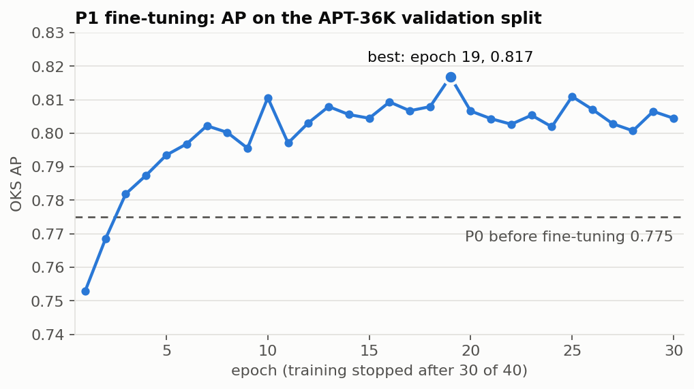
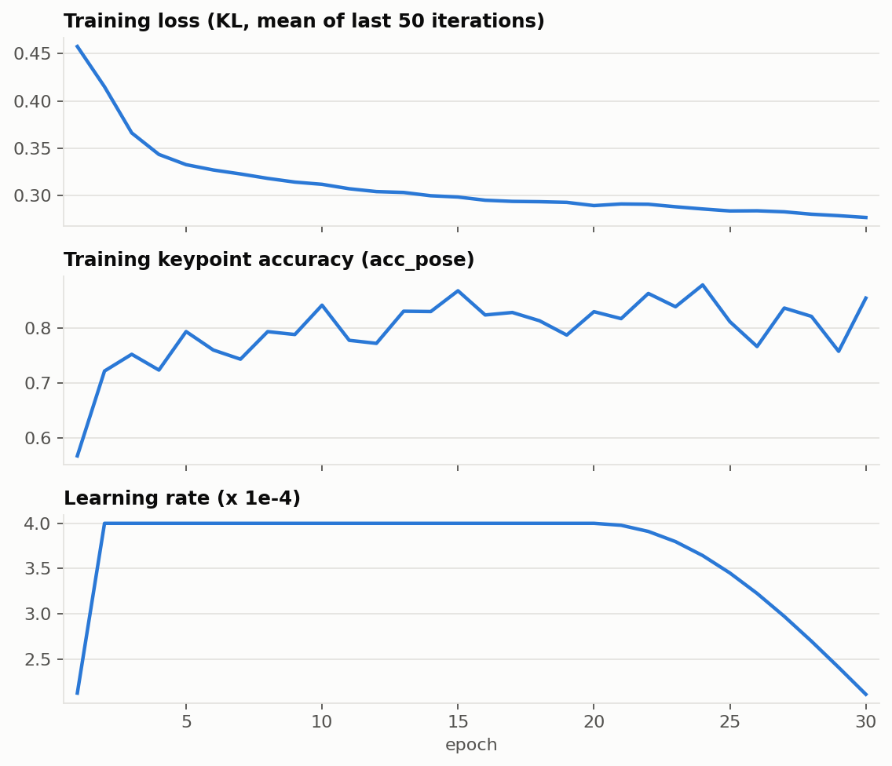
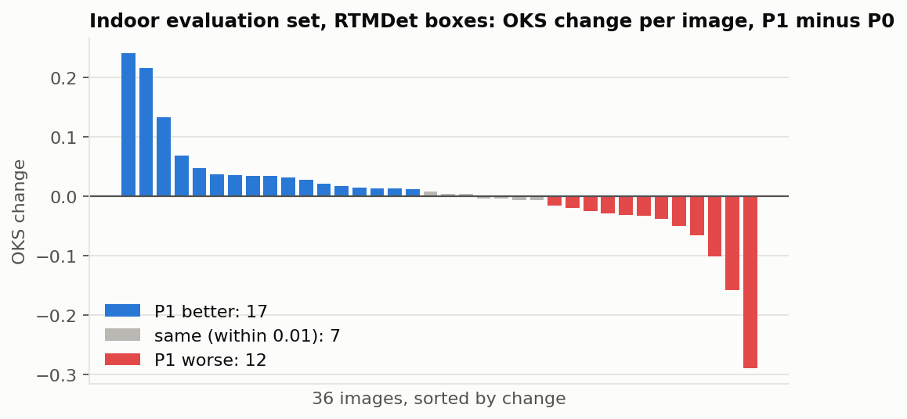
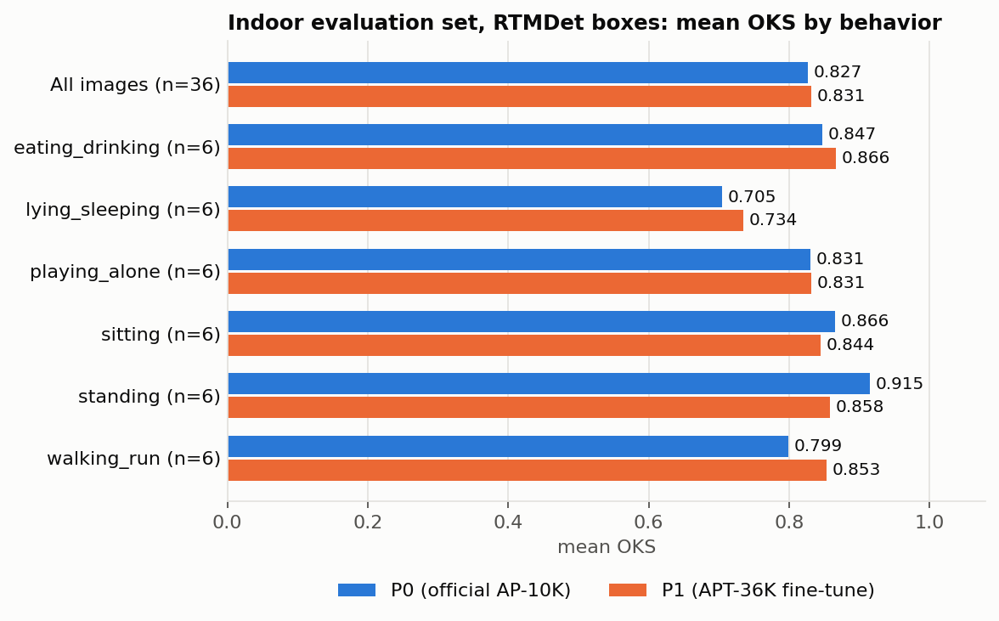
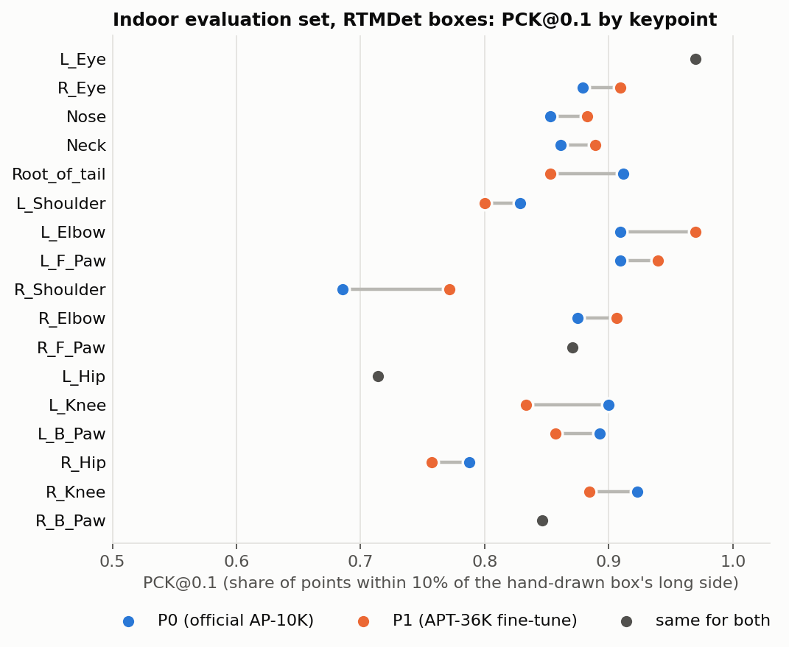

# P1：用 APT-36K 微调狗姿态模型的过程与结果

记录日期：2026-10-13（训练和评测都在这一天完成）

## 1. 结论

- P1 是在官方 RTMPose-m AP-10K 权重（P0）基础上，用 APT-36K 的狗数据继续训练 30 轮得到的模型。
- 在 APT-36K 自己的验证集上，AP 从 0.775 涨到 0.817（第 19 轮最好）。
- 在 36 张室内人工标注帧上，按实际流程（RTMDet 检测狗 → 姿态模型估计关键点）评测骨架，P1 和 P0 **打平**：平均 OKS 0.831 对 0.827，逐张变化 +0.004（95% 置信区间 −0.024 到 +0.032）。
- 没有证据说明 P1 更好，因此项目继续使用 P0。APT-36K 上的提升没有迁移到室内场景。

## 2. 微调是怎么做的

### 2.1 模型和起点

| 项目 | 设置 |
|---|---|
| 模型结构 | RTMPose-m：CSPNeXt-m 主干 + RTMCCHead，SimCC 坐标分类（split ratio 2.0） |
| 输入尺寸 | 256×256，自顶向下（先有狗的框，再估计框内的 17 个关键点） |
| 关键点 | AP-10K 的 17 点（眼、鼻、颈、尾根、四肢各 3 点） |
| 起点权重（P0） | 官方 `rtmpose-m_simcc-ap10k_pt-aic-coco_210e-256x256-7a041aa1_20230206.pth` |
| 损失函数 | KLDiscretLoss（官方配置，未改） |
| 冻结 | 不冻结，全部参数一起训练 |

### 2.2 训练数据：APT-36K 狗子集

| 项目 | 数量 |
|---|---|
| 原始标注 | 1193 张图、2245 个狗标注、27 个源视频（80 个片段文件夹），全部 1920×1080 |
| 清洗 | 去掉 180 个没有任何关键点的标注，剩 2065 个；重算每个标注的可见点数 |
| 训练集 | 24 个视频、983 张图、1691 只狗 |
| 验证集 | 3 个视频（`clip4`、`v14`、`v19`）、209 张图、374 只狗 |
| 划分方式 | 按源视频划分，同一视频的片段不跨训练/验证；随机种子 0，验证约占 15% |

APT-36K 的关键点只有"已标 / 未标"两种状态，没有"被遮挡但已标"这一类。选 APT-36K 而不是 AP-10K，是因为 P0 本身已经在 AP-10K 上训练过。

### 2.3 训练设置

| 项目 | P1 的设置 | 官方 AP-10K 配置 |
|---|---|---|
| 轮数 | 计划 40 轮，**实际在第 30 轮后手动停止** | 210 |
| 学习率 | 4e-4 | 4e-3 |
| 学习率策略 | 前 50 次迭代线性预热；第 20 轮起余弦下降 | 前 1000 次迭代预热；后半程余弦下降 |
| 优化器 | AdamW，weight decay 0.05 | 相同 |
| 批大小 | 64（每轮 27 次迭代） | 64×8 卡 |
| 数据增强 | 随机翻转、半身、缩放 0.6–1.4、旋转 ±80°、HSV 抖动、模糊、随机遮挡 | 相同 |
| 权重平均 | EMA | 相同 |
| 模型选择 | 每轮在 APT 验证集上评测，保留 AP 最高的一轮 | 每 10 轮评测 |
| 随机种子 | 21 | 21 |

配置里原定最后 10 轮（第 31–40 轮）换成较轻的数据增强，因为训练在第 30 轮后停止，这一阶段**没有执行**。

### 2.4 环境和耗时

| 项目 | 内容 |
|---|---|
| 环境 | conda `PRS-project`：Python 3.10，PyTorch 2.1.0（CPU），MMCV 2.1.0，MMDetection 3.2.0，MMPose 1.3.2 |
| 硬件 | 笔记本 CPU（Intel Core Ultra 7 255H，16 核），未使用 GPU |
| 为什么用 CPU | MMCV 没有适配 RTX 5060 所需 CUDA 12.8 的 Windows 预编译包 |
| 耗时 | 30 轮共约 67 分钟（20:12 开始，21:19 结束），每轮训练约 2 分钟、验证约 11 秒 |

## 3. 30 轮的训练过程

### 3.1 APT-36K 验证集上的 AP



- 第 1 轮 AP（0.753）低于训练前的 P0（0.775），第 3 轮起超过 P0。
- 第 10 轮之后在 0.80–0.82 之间波动，不再明显上升；最高是第 19 轮的 0.817。
- 验证集只有 3 个视频，相邻两轮 ±0.01 的波动属于正常噪声。

### 3.2 训练损失、训练准确率和学习率



- 损失从 0.458 一直降到 0.277，到第 30 轮仍在缓慢下降。
- 验证 AP 在第 10 轮后已经走平，而训练损失还在降，说明后面的训练主要是在拟合 APT-36K 训练集。
- `acc_pose` 是 MMPose 在训练批次上算的关键点准确率，受数据增强影响波动较大，只适合看趋势。

### 3.3 逐轮数据

学习率单位是 1e-4；训练损失和 `acc_pose` 是最近 50 次迭代的平均。完整数据在 `data/p1_apt_val_per_epoch.csv`。

| 轮 | 学习率 | 训练损失 | acc_pose | 验证 AP | AP50 | AP75 | AR |
|---|---|---|---|---|---|---|---|
| P0（训练前） | – | – | – | 0.775 | 0.940 | 0.882 | 0.814 |
| 1 | 2.12 | 0.458 | 0.568 | 0.753 | 0.930 | 0.830 | 0.792 |
| 2 | 4.00 | 0.415 | 0.722 | 0.768 | 0.929 | 0.852 | 0.804 |
| 3 | 4.00 | 0.366 | 0.753 | 0.782 | 0.940 | 0.870 | 0.817 |
| 4 | 4.00 | 0.344 | 0.724 | 0.787 | 0.940 | 0.871 | 0.823 |
| 5 | 4.00 | 0.333 | 0.794 | 0.793 | 0.949 | 0.880 | 0.830 |
| 6 | 4.00 | 0.327 | 0.761 | 0.797 | 0.949 | 0.871 | 0.832 |
| 7 | 4.00 | 0.323 | 0.744 | 0.802 | 0.949 | 0.880 | 0.835 |
| 8 | 4.00 | 0.318 | 0.794 | 0.800 | 0.950 | 0.872 | 0.834 |
| 9 | 4.00 | 0.314 | 0.789 | 0.796 | 0.949 | 0.882 | 0.831 |
| 10 | 4.00 | 0.312 | 0.842 | 0.811 | 0.960 | 0.891 | 0.845 |
| 11 | 4.00 | 0.307 | 0.778 | 0.797 | 0.950 | 0.879 | 0.836 |
| 12 | 4.00 | 0.304 | 0.773 | 0.803 | 0.950 | 0.869 | 0.839 |
| 13 | 4.00 | 0.304 | 0.831 | 0.808 | 0.960 | 0.880 | 0.844 |
| 14 | 4.00 | 0.300 | 0.831 | 0.806 | 0.950 | 0.889 | 0.840 |
| 15 | 4.00 | 0.299 | 0.869 | 0.804 | 0.951 | 0.880 | 0.840 |
| 16 | 4.00 | 0.295 | 0.825 | 0.809 | 0.950 | 0.878 | 0.844 |
| 17 | 4.00 | 0.294 | 0.829 | 0.807 | 0.950 | 0.879 | 0.840 |
| 18 | 4.00 | 0.294 | 0.814 | 0.808 | 0.950 | 0.891 | 0.842 |
| **19（最好）** | 4.00 | 0.293 | 0.788 | **0.817** | 0.960 | 0.891 | 0.848 |
| 20 | 4.00 | 0.290 | 0.831 | 0.807 | 0.950 | 0.878 | 0.841 |
| 21 | 3.98 | 0.291 | 0.818 | 0.804 | 0.940 | 0.881 | 0.838 |
| 22 | 3.91 | 0.291 | 0.864 | 0.803 | 0.940 | 0.880 | 0.838 |
| 23 | 3.80 | 0.288 | 0.839 | 0.805 | 0.950 | 0.879 | 0.839 |
| 24 | 3.64 | 0.286 | 0.879 | 0.802 | 0.940 | 0.870 | 0.836 |
| 25 | 3.45 | 0.284 | 0.812 | 0.811 | 0.950 | 0.881 | 0.843 |
| 26 | 3.23 | 0.284 | 0.767 | 0.807 | 0.949 | 0.880 | 0.843 |
| 27 | 2.97 | 0.283 | 0.837 | 0.803 | 0.940 | 0.880 | 0.835 |
| 28 | 2.70 | 0.281 | 0.822 | 0.801 | 0.940 | 0.880 | 0.837 |
| 29 | 2.41 | 0.279 | 0.758 | 0.807 | 0.940 | 0.880 | 0.840 |
| 30 | 2.11 | 0.277 | 0.855 | 0.804 | 0.940 | 0.879 | 0.839 |

## 4. 在室内评估集上对比 P0 和 P1

本节评估的是**骨架（17 个关键点）的准确度**。主要结果用的是实际系统的流程：先用 RTMDet 检测狗，再让姿态模型在检测框里估计关键点。让姿态模型直接在人工框里预测的结果作为对照列在 4.3 节。数字对应评估集的最终版本（36 张；2026-10-17 最后一次修改：`d013_v11_c002` 的片段时间和标签更正后，把原来取自它的 `d013_v11_c002_f0019` 换成了同一只狗进食的 `d013_v11_c003_f0030`）。

### 4.1 评估集和评测方法

| 项目 | 内容 |
|---|---|
| 评估集 | 36 张室内监控帧，6 类行为每类 6 张，来自 28 只狗（28 个源视频）；全部人工标注，共 547 个关键点 |
| 标注规则 | 只标能确定位置的可见点；被遮挡、无法判断的点不标，不计入得分 |
| 选帧 | 人工也无法辨认关键点的严重模糊帧不放入评估集 |
| 检测模型 | RTMDet-m（官方 COCO 权重），不训练，直接使用 |
| 检测后处理 | 只保留"人"和"狗"两个框；猫、牛、马、羊、熊等四足动物类别的框都算作狗，取得分最高的一个；得分低于 0.3 视为没检测到 |
| 姿态模型的输入框 | RTMDet 检测出的狗框 |
| 人工框的用途 | 作为真值：给得分定标尺、衡量检测框的质量；另外作为对照输入跑一遍（4.3 节） |
| P1 用的权重 | 第 19 轮（APT 验证 AP 最高），导出为 ONNX |
| 公平性检查 | 用同一段导出代码重新导出 P0，与官方 ONNX 在评估图上的结果完全一致，说明两个模型的前后处理相同 |
| OKS | 预测骨架与人工标注骨架的相似度，1 为完全重合；用 AP-10K 的 sigma，人工框的面积代替分割面积 |
| PCK@0.1 | 预测点与真值的距离不超过人工框长边 10% 的点所占比例 |
| 漏检的处理 | 没检测到狗的图，所有已标的点都算错（这次 36 张都检测到了） |

评估集的图不在 P1 的训练数据里（P1 只用了 APT-36K）。

**无法判断的点一律不标。** 评估集的人工标注只保留能确定位置的可见点；被身体、家具遮挡或出了画面、无法判断位置的点全部没有标，既不猜位置，也不用"遮挡"标记代替。这类点不计入任何得分。

| 项目 | 数量 |
|---|---|
| 36 张 × 17 个关键点 | 612 |
| 已标（可见、位置确定） | 547（89%） |
| 未标（遮挡或无法判断） | 65（11%） |
| 未标最多的关键点 | `R_Knee`、`R_B_Paw` 各 10 个，`L_B_Paw` 8 个，`L_Knee` 6 个 |

- 这样标与 AP-10K 的做法一致（AP-10K 也只标可见点），所以 4.6 节可以和官方成绩对比。
- 代价是：本节的所有得分只反映**可见关键点**的准确度，被遮挡的关节估得准不准没有评估。
- 姿态模型的输出不受这条规则影响：RTMPose 每帧都会输出全部 17 个点。在这 65 个未标的位置上，P0 照样给出了坐标，只是置信度较低（中位数 0.46，已标的点是 0.79）。模型二拿到的骨架里包含这些点。

### 4.2 RTMDet 的检测情况

| 项目 | 结果 |
|---|---|
| 检测到狗（得分 ≥ 0.3） | 36 / 36 |
| 狗框来自哪个 COCO 类别 | 狗 27 张，猫 8 张，牛 1 张 |
| 与人工框的 IoU | 中位数 0.83，最低 0.63，没有低于 0.5 的 |

- RTMDet 对狗的定位很准，问题在类别：36 张里有 9 张它给别的四足动物类别的得分高于"狗"。所以后处理把四足动物类别都并入"狗"。
- 这个做法的前提是画面里只有狗这一只动物；家里如果有真的猫，会被当成狗。

### 4.3 骨架的总体结果

| 姿态模型的输入框 | 模型 | OKS AP | AP50 | AP75 | 平均 OKS | PCK@0.05 | PCK@0.1 |
|---|---|---|---|---|---|---|---|
| **RTMDet 的框（实际流程）** | P0（官方 AP-10K） | 0.678 | 0.970 | 0.762 | 0.827 | 0.682 | 0.857 |
| **RTMDet 的框（实际流程）** | P1（APT-36K 微调） | 0.693 | 1.000 | 0.754 | 0.831 | 0.680 | 0.861 |
| 人工框（对照） | P0（官方 AP-10K） | 0.700 | 0.970 | 0.825 | 0.839 | 0.695 | 0.868 |
| 人工框（对照） | P1（APT-36K 微调） | 0.698 | 1.000 | 0.758 | 0.832 | 0.654 | 0.857 |

逐张配对比较（P1 减 P0 的 OKS，bootstrap 按图片重采样 10000 次）：

| 姿态模型的输入框 | 平均变化 | 95% 置信区间 | 变好 | 持平（±0.01 内） | 变差 |
|---|---|---|---|---|---|
| RTMDet 的框 | +0.004 | −0.024 到 +0.032 | 17 | 7 | 12 |
| 人工框 | −0.007 | −0.028 到 +0.013 | 11 | 11 | 14 |

- 两种输入框下，置信区间都包含 0，而且方向相反：P1 和 P0 打平。
- 检测这一步对骨架的损失很小：P0 的平均 OKS 从人工框的 0.839 降到 RTMDet 框的 0.827。



RTMDet 的框下变化最大的几张（完整列表在 `data/indoor_eval_per_image.csv`，里面同时有两种输入框的得分、检测得分、检测类别和 IoU）：

| 图片 | 行为 | P0 | P1 | 变化 |
|---|---|---|---|---|
| `d008_v05_c001_f0005` | standing | 0.824 | 0.535 | −0.29 |
| `d004_v04_c006_f0048` | lying_sleeping | 0.774 | 0.616 | −0.16 |
| `d009_v06_c002_f0023` | walking_run | 0.721 | 0.854 | +0.13 |
| `d019_v17_c003_f0080` | walking_run | 0.555 | 0.772 | +0.22 |
| `d023_v22_c001_f0001` | lying_sleeping | 0.480 | 0.722 | +0.24 |

### 4.4 按行为类别（RTMDet 的框）



| 行为 | 张数 | P0 平均 OKS | P1 平均 OKS | 变化 | P0 PCK@0.1 | P1 PCK@0.1 |
|---|---|---|---|---|---|---|
| 全部 | 36 | 0.827 | 0.831 | +0.004 | 0.857 | 0.861 |
| eating_drinking | 6 | 0.847 | 0.866 | +0.019 | 0.927 | 0.948 |
| lying_sleeping | 6 | 0.705 | 0.734 | +0.029 | 0.802 | 0.779 |
| playing_alone | 6 | 0.831 | 0.831 | 0.000 | 0.833 | 0.833 |
| sitting | 6 | 0.866 | 0.844 | −0.021 | 0.868 | 0.831 |
| standing | 6 | 0.915 | 0.858 | −0.056 | 0.950 | 0.920 |
| walking_run | 6 | 0.799 | 0.853 | +0.054 | 0.750 | 0.837 |

- 各类互有胜负：P1 在走跑、进食、趴卧上略高，在站立和坐着上略低，玩耍持平。每类只有 6 张，这些差别都在噪声范围内。
- 趴卧（lying_sleeping）是两个模型共同最弱的一类，比其他类低 0.1 左右。

### 4.5 按关键点（RTMDet 的框）



| 关键点 | 已标数量 | P0 PCK@0.1 | P1 PCK@0.1 | 变化 |
|---|---|---|---|---|
| L_Eye | 33 | 0.970 | 0.970 | 0.000 |
| R_Eye | 33 | 0.879 | 0.909 | +0.030 |
| Nose | 34 | 0.853 | 0.882 | +0.029 |
| Neck | 36 | 0.861 | 0.889 | +0.028 |
| Root_of_tail | 34 | 0.912 | 0.853 | −0.059 |
| L_Shoulder | 35 | 0.829 | 0.800 | −0.029 |
| L_Elbow | 33 | 0.909 | 0.970 | +0.061 |
| L_F_Paw | 33 | 0.909 | 0.939 | +0.030 |
| R_Shoulder | 35 | 0.686 | 0.771 | +0.086 |
| R_Elbow | 32 | 0.875 | 0.906 | +0.031 |
| R_F_Paw | 31 | 0.871 | 0.871 | 0.000 |
| L_Hip | 35 | 0.714 | 0.714 | 0.000 |
| L_Knee | 30 | 0.900 | 0.833 | −0.067 |
| L_B_Paw | 28 | 0.893 | 0.857 | −0.036 |
| R_Hip | 33 | 0.788 | 0.758 | −0.030 |
| R_Knee | 26 | 0.923 | 0.885 | −0.038 |
| R_B_Paw | 26 | 0.846 | 0.846 | 0.000 |

- 两个模型各有胜负，没有一边倒：P1 在头部、颈和前肢略好，在尾根、右髋和后腿略差。
- 两个模型共同的弱点是右肩和髋：`R_Shoulder`（0.686 / 0.771）、`L_Hip`（0.714 / 0.714）、`R_Hip`（0.788 / 0.758）。
- 每个关键点只有 26–36 个样本，单个点 ±0.03 的差别相当于一个点的出入。

### 4.6 与 RTMPose 官方成绩的对比

P0 就是 MMPose 官方发布的 RTMPose-m AP-10K 权重，官方在 AP-10K 测试集上报告了它的成绩（来源：MMPose 随模型发布的 `rtmpose_ap10k.yml`）。和室内评估集上的 P0 放在一起：

| 评测数据 | AP | AP50 | AP75 |
|---|---|---|---|
| 官方：AP-10K 测试集（54 种动物） | 0.722 | 0.939 | 0.788 |
| 官方：AP-10K 测试集中的大尺寸动物 | 0.728 | – | – |
| 室内 36 张，人工框（与官方同样用人工框） | 0.700 | 0.970 | 0.825 |
| 室内 36 张，RTMDet 的框（实际流程） | 0.678 | 0.970 | 0.762 |

室内 AP 的 95% 置信区间（按图片重采样 2000 次）：人工框 0.623 到 0.775，RTMDet 的框 0.590 到 0.760。

- 最公平的对比是人工框下的 0.700 对官方大尺寸动物的 0.728：两边都用人工框，室内的狗在画面里基本都是大尺寸。差 0.028，且官方成绩落在室内的置信区间内，**没有明显差距**。
- 室内的数字偏乐观：只标了能确定的可见点，严重模糊的帧不在评估集里，每张图只有一只体型较大的狗。官方测试集还包含中等尺寸的动物（这部分 AP 只有 0.569）。
- 也有一点对室内不利：官方评测把图片左右翻转再预测一次、两次取平均（flip test），一般能多 0.5 到 1 个点；室内评测的 ONNX 推理没有这一步。
- 官方没有单独公布 AP-10K 中"狗"这一类的 AP，只能和全部动物的成绩比。
- 结论：P0 在室内狗上的整体表现已接近它在自己基准上的水平，这也解释了为什么用 APT-36K 微调没有带来提升。但平均数掩盖了趴卧这一短板（4.4 节，平均 OKS 比其他类低约 0.1）。

## 5. 怎么解读这个结果

可以支持的说法：

- 在 36 张室内人工标注帧上，按 RTMDet 检测加姿态估计的完整流程评测，APT-36K 微调后的骨架准确度与微调前没有可检测的差别，因此保留官方 AP-10K 权重。
- P1 在 APT-36K 验证集上涨了约 4 个点，在室内却没有涨，说明 APT-36K 的场景和室内监控场景差别较大，学到的东西没有迁移过来。
- 两个模型在室内的弱点相同：趴卧姿态，以及右肩和髋这几个容易被身体挡住的点。
- P0 在室内评估集上的 AP（人工框 0.700）与官方在 AP-10K 上报告的成绩（0.722，大尺寸动物 0.728）没有明显差距（4.6 节）。

不能支持的说法：

- "P1 更好"或"P1 更差"：两种输入框下置信区间都包含 0。
- "微调没有用"：这里只试了一组超参数、只用了 APT-36K、只训练了 30 轮。用室内数据微调（P2）有没有用，没有测。

写报告时应注明的限制：

- 样本只有 36 张，每类 6 张，分类别的数字只能看方向。
- 只评估了可见点，被遮挡的关节没有评估；严重模糊、人工无法标注的帧没有放进评估集。
- 评估集每张图都有狗、没有别的动物：没有测画面里无狗或有真猫的情况，也没有评估 RTMDet 的"人"框。
- 只有一位标注人，没有标注误差的估计。
- APT 验证集只有 3 个视频，按它选出的"最好一轮"带有偶然性。

## 6. 相关文件和复现方法

| 内容 | 位置 |
|---|---|
| 微调配置 | `pet_recognition_system/configs/rtmpose/rtmpose-m_apt36k-dog_finetune.py` |
| 数据划分脚本 | `pet_recognition_system/tools/prepare_apt36k_split.py` |
| 训练 / 测试脚本 | `pet_recognition_system/tools/train_pose.py` |
| ONNX 导出脚本 | `pet_recognition_system/tools/export_rtmpose_onnx.py` |
| 评测脚本 | `pet_recognition_system/tools/eval_pose.py` |
| RTMDet 封装（只保留人和狗） | `pet_recognition_system/pet_recognition/models/rtmdet.py` |
| 检测并保存狗框 | `pet_recognition_system/tools/detect_boxes.py`，结果在 `outputs/eval_boxes_rtmdet.json`（本地，不进仓库） |
| 训练日志（本地，不进仓库） | `pet_recognition_system/work_dirs/p1_train.log` |
| P1 权重（本地，不进仓库） | `work_dirs/rtmpose-m_apt36k-dog_finetune/best_coco_AP_epoch_19.pth`、`checkpoints/p1_apt36k_epoch19.onnx` |
| 本文的图和数据表 | 本文件夹的 `figures/`、`data/`，由 `make_p1_figures.py` 生成 |

在 `pet_recognition_system/` 下，`PRS-project` 环境里，先把 `PET_DATA_ROOT` 设为本地数据目录：

```bash
python tools/prepare_apt36k_split.py
python tools/train_pose.py configs/rtmpose/rtmpose-m_apt36k-dog_finetune.py --test
python tools/train_pose.py configs/rtmpose/rtmpose-m_apt36k-dog_finetune.py
python tools/export_rtmpose_onnx.py configs/rtmpose/rtmpose-m_apt36k-dog_finetune.py work_dirs/rtmpose-m_apt36k-dog_finetune/best_coco_AP_epoch_19.pth checkpoints/p1_apt36k_epoch19.onnx
python tools/detect_boxes.py
python tools/eval_pose.py P0=$PET_DATA_ROOT/models/rtmpose-m_ap10k/end2end.onnx P1=checkpoints/p1_apt36k_epoch19.onnx --boxes outputs/eval_boxes_rtmdet.json
```

第二行是训练前用 P0 在 APT 验证集上测基准（得到 0.775）。倒数第二行用 RTMDet 检测评估图里的狗；最后一行去掉 `--boxes` 就是用人工框的对照结果。重新生成本文的图表：在本文件夹运行 `python make_p1_figures.py`。
