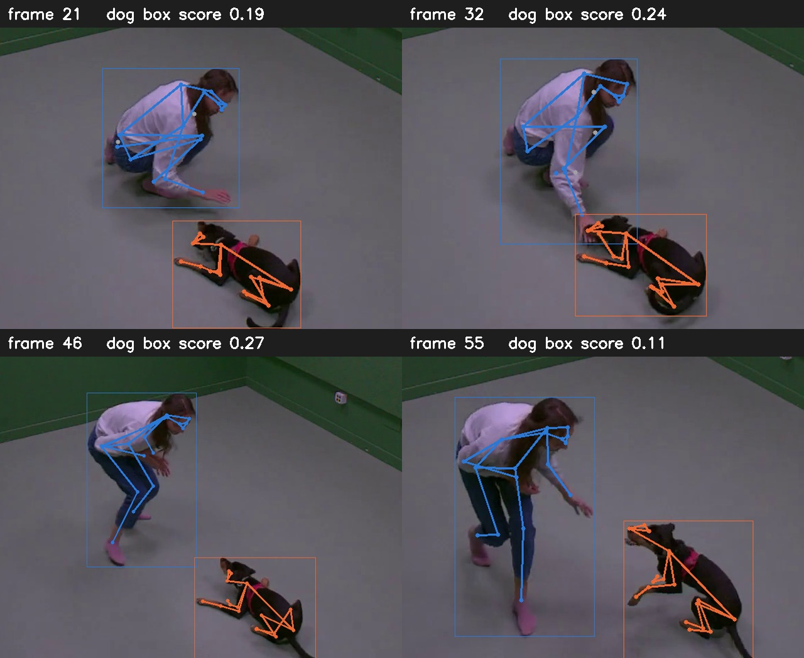

# 骨架提取：趴卧狗的检测与跟踪优化

记录日期：2026-10-17

## 1. 背景

模型二（ST-GCN）的输入是骨架序列：每个视频片段抽成 15 fps，每帧先用 RTMDet-m（官方 COCO 权重）找出人和狗，再分别用 RTMPose-m 估计人和狗各 17 个关键点，输出 2 条流 × T 帧 × 17 关节 × [x, y, 置信度]；没检测到目标的帧整帧填 0。

每帧画面里可能有不止一个人或一只狗（甚至有猫），所以需要一条选框规则，保证整段视频跟住同一个目标。本文记录这条规则的优化。

此前已有的检测后处理（见 `P1(APT-36k微调)/P1_APT36K微调记录.md` 第 4.2 节）：只保留"人"和"狗"两个框；猫、牛、马、羊、熊等四足动物类别的框都算作狗，因为 COCO 模型经常把室内的狗认成猫。

## 2. 发现的问题

从全部片段里按类别均匀挑了 14 段生成带骨架的视频人工审查（6 类狗行为各 1 段，4 类人狗互动各 2 段）。其中两段狗缺帧明显，人工查看发现**两段缺帧时狗都是趴着的**：

| 片段 | 类型 | 帧数 | 缺狗的帧 | 原因 |
|---|---|---|---|---|
| `d26_p27_v01_c001` | 人狗互动：一起玩 | 90 | 35（39%） | 狗趴下后检测器给的分数只有 0.10–0.30，低于 0.3 的阈值 |
| `d002_v02_c004` | 狗行为：sitting | 67 | 7（最后 7 帧） | 狗趴下后检测框的位置跳开，和上一帧的框完全不重合，跟丢 |

把缺帧单独拿出来分析：

- **`d26`**：35 个缺帧里，有 26 帧检测器其实仍框住了狗，只是分数在 0.10–0.30 之间，而且这个框和上一帧的狗框高度重合（IoU 大多 0.6–0.98），说明就是同一只狗原地趴着；只有 9 帧分数低于 0.1 或不重合，是真的找不到。
- **`d002`**：最后 7 帧里检测器给出的狗框分数很高（0.74–0.80），但和之前保存的框 IoU 为 0。按旧规则，后面的帧再也接不上。

## 3. 选框规则的演变

| 版本 | 规则 | 问题 |
|---|---|---|
| 1 | 每帧都选分数最高的框 | 画面里有两只狗时，相邻帧可能选到不同的狗，骨架序列来回跳 |
| 2 | 第一帧选分数最高；之后选和上一帧重合最多的框，没有重合时退回选分数最高 | 退回按分数选时，仍可能跳到另一只动物 |
| 3 | 第一帧选分数最高；之后**只**选和上一帧重合最多、分数 ≥ 0.3 的框，没有就算没检测到 | 本文发现的两个问题：趴着分数低被丢掉；框跳开后永远接不上 |
| **4（现在）** | 在版本 3 基础上加两条：**低分接续**和**跟丢后重新找回**（见下） | 见第 5 节 |

### 版本 4 的两条新增规则

1. **低分接续**：已经在跟的目标，如果某个框和上一帧的框重合度 IoU ≥ 0.5，分数 ≥ 0.1 就接受。原来"分数 ≥ 0.3 且有重合"的情况照旧接受。要求高重合度，是为了不把别处的低分误检当成狗。
2. **跟丢后重新找回**：同一个目标连续 3 帧没接上，就丢掉旧轨迹，下一帧像第一帧那样重新选分数最高（≥ 0.3）的框。

人和狗两条流都按同样的规则处理。

| 参数 | 值 | 含义 |
|---|---|---|
| 新目标的分数门槛 | 0.3 | 第一次选中、或重新找回时，框的分数至少要这么高 |
| 正常接续 | 分数 ≥ 0.3 且 IoU > 0 | 和上一帧的框有重合即可 |
| 低分接续 | 分数 ≥ 0.1 且 IoU ≥ 0.5 | 针对趴卧时分数偏低 |
| 重新找回 | 连续 3 帧没接上 | 3 帧在 15 fps 下是 0.2 秒 |

## 4. 效果

| 片段 | 版本 3 检测到狗 | 版本 4 检测到狗 | 版本 4 仍缺的帧 |
|---|---|---|---|
| `d26_p27_v01_c001` | 55 / 90（61%） | 78 / 90（87%） | 12 帧 |
| `d002_v02_c004` | 60 / 67（90%） | 64 / 67（96%） | 3 帧（跟丢后、重新找回前） |

`d26` 找回的帧里，狗框分数在 0.11–0.30 之间。下图是其中 4 帧（第 21、32、46、55 帧）：狗框分数都低于 0.3，按版本 3 会被丢掉，版本 4 接续上了。人（蓝色）和趴着的黑狗（橙色）都被完整框住，17 个关键点全部输出，狗的关键点置信度都在 0.3 以上：

## 5. 仍存在的问题和风险

- **检测器完全漏检的帧救不回来**：`d26` 还缺 12 帧，大多是黑狗趴在灰地上、检测器没有给出任何可用的框。要根本解决，需要用室内趴卧的狗微调检测器。
- **部分框不完整**：`d26` 第 4 帧接续的是一个只框住狗头附近的小框（分数 0.17），骨架画在小框里，不完整。这类帧的关键点置信度低，模型二可以靠置信度少依赖它们。
- **低分接续可能误跟**：狗离开后，原位置如果有像狗的物体被打了低分，可能被当成狗继续跟。要求 IoU ≥ 0.5 能挡掉大部分这种情况，但没有专门测试过。
- **重新找回可能换目标**：跟丢 3 帧后按分数重新选框，画面里有两只动物时（例如 `d003_v03_c001` 桌上有一只无毛猫，被检测器认成了狗），可能换成另一只。
- **其他片段没有重新验证**：审查的 14 段里只有 `d26` 和 `d002` 用新规则重新生成了视频；`d30_p32_v01_c001`、`d56_p58_v01_c002` 之前也各有 3、4 帧属于跟丢，按新规则应该能找回，但没有重跑确认。

## 6. 对报告的意义

- 趴卧（`lying_sleeping`）是整条流程最弱的一类，两个环节叠加：检测框更容易丢，姿态本身也最不准（室内评估集上 P0 的平均 OKS 为 0.705，比其他类低约 0.1）。
- 版本 4 只改善了"检测器给了低分框"的情况；"完全没检测到"的帧仍是 0，模型二需要能处理骨架中缺失的帧。

## 7. 相关代码

| 内容 | 位置 |
|---|---|
| 选框规则（`choose`）和低分接续参数 | `pet_recognition_system/pet_recognition/models/rtmdet.py` |
| 逐帧流程、跟丢后重新找回 | `pet_recognition_system/pet_recognition/inference/skeleton.py` |
| 命令行入口 | `pet_recognition_system/tools/extract_skeletons.py`（加 `--video` 生成审查视频） |
| 测试 | `pet_recognition_system/tests/test_rtmdet_choose.py`、`tests/test_extract_skeletons.py` |
| 审查片段清单 | `pet_recognition_system/outputs/review/review_clips.csv`（本地，不进仓库） |
